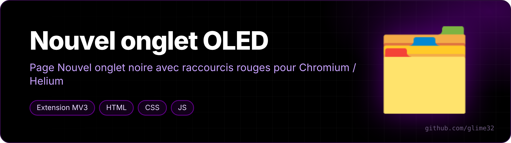

  

<a href="README.md">🇬🇧 English version</a>

> **Remplacé par [nouvel-onglet-cours](https://github.com/glime32/nouvel-onglet-cours).** Ce dépôt n'est plus mis à jour.

Une page « Nouvel onglet » toute noire avec des raccourcis ronds rouges, pour [Helium](https://github.com/imputnet/helium) et les autres navigateurs Chromium.

Je l'ai faite pour aller avec mon thème noir OLED / violet (voir [stylus-oled](https://github.com/glime32/stylus-oled)) : Helium ne permet pas de changer la couleur des tuiles de sa page d'accueil, et Stylus n'a pas accès aux pages internes du navigateur. Le seul moyen, c'est de remplacer la page.

## Fonctionnalités

- fond noir `#000000`, tuiles rouges `#ff3b3b`, accents violets `#610089` ;
- chaque favicon est posée sur un rond noir, sinon les logos rouges (YouTube...) disparaissent sur le rouge ;
- **+** pour ajouter un raccourci, la petite croix violette au survol pour en supprimer un ;
- les raccourcis sont gardés en `localStorage`, les icônes viennent de l'API favicon de Chrome (aucune requête vers un service externe) ;
- aucun script en arrière-plan, la page ne coûte rien quand elle n'est pas ouverte.

## Installation

1. Télécharger ce dépôt (*Code → Download ZIP*) et le décompresser.
2. Ouvrir `chrome://extensions` (ou `helium://extensions`).
3. Activer le *Mode développeur*.
4. *Charger l'extension non empaquetée* → choisir le dossier.

Les raccourcis par défaut se modifient directement depuis la page, ou dans `PAR_DEFAUT` en haut de `newtab.js`.
