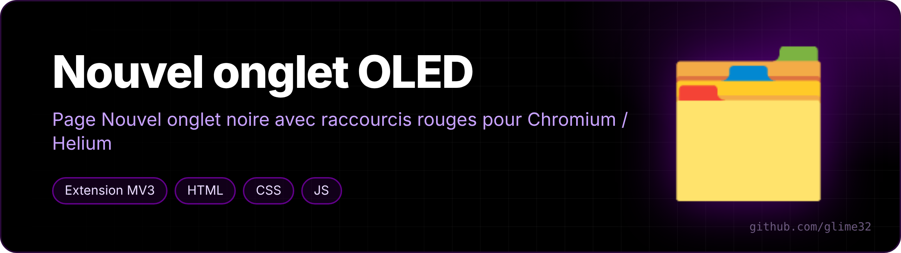
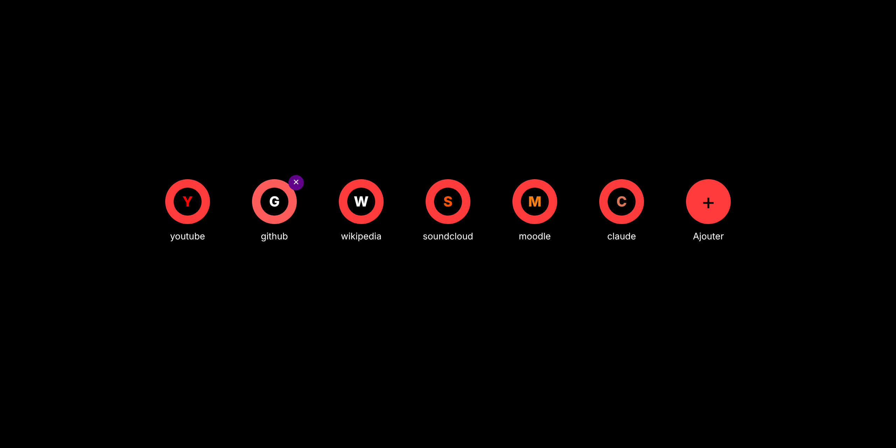
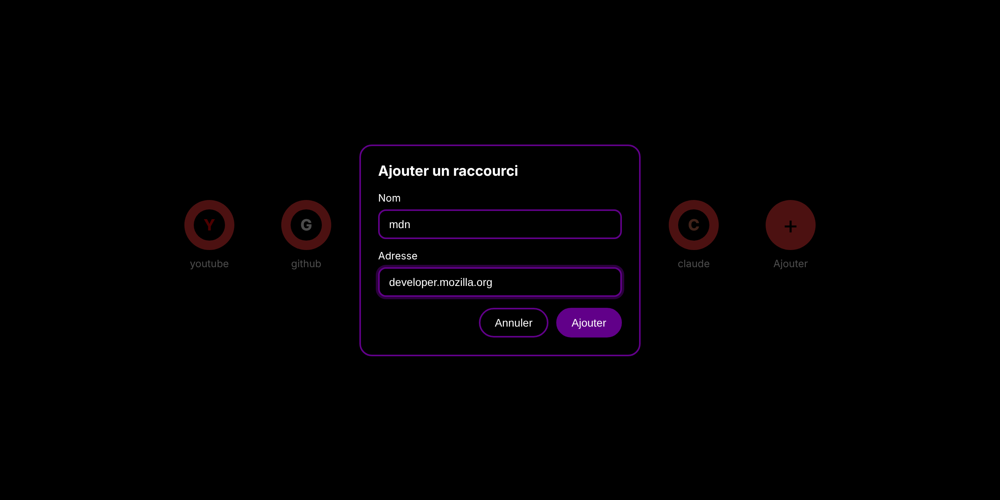

  

<a href="README.fr.md">🇫🇷 Version française</a>

> **Superseded by [nouvel-onglet-cours](https://github.com/glime32/nouvel-onglet-cours).** This repo is no longer updated.

**A pure black "New tab" page with round red shortcuts**, for [Helium](https://github.com/imputnet/helium) and other Chromium browsers.

Made to match my OLED black / purple theme ([stylus-oled](https://github.com/glime32/stylus-oled)): Helium doesn't let you change its new-tab tile colors, and Stylus can't reach internal browser pages — replacing the page is the only way.

## Features

- `#000000` background, red `#ff3b3b` tiles, purple `#610089` accents;
- each favicon sits on a black circle so red logos don't vanish on red (the preview above shows letters instead of real favicons);
- **+** to add a shortcut, the small purple cross on hover to remove one;
- shortcuts stored in `localStorage`, icons from Chrome's built-in favicon API (no external requests);
- no background script at all.

## Install

1. *Code → Download ZIP* and unzip it.
2. Open `chrome://extensions` (or `helium://extensions`).
3. Enable *Developer mode*.
4. *Load unpacked* → pick the folder.
